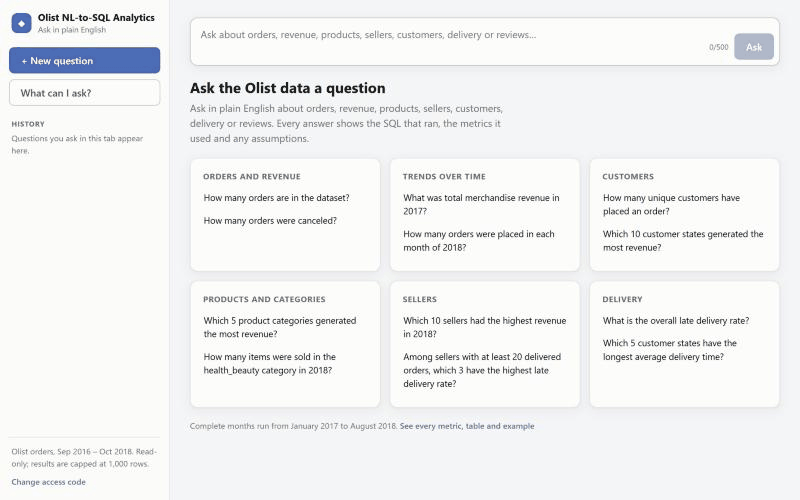
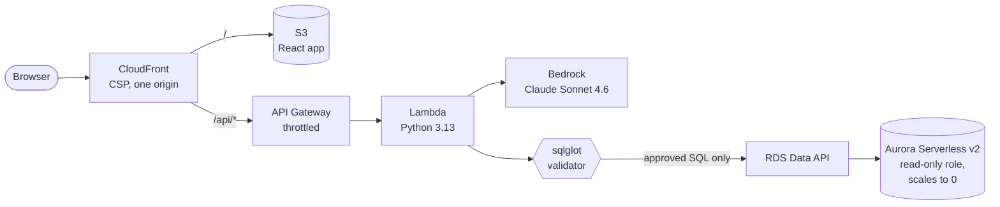

# olist-nl-sql

Ask questions about the [Olist e-commerce dataset][olist] in plain English. You get
back the answer as a chart and a table, along with the SQL that produced it and any
assumptions the model made along the way.



**Live demo:** <https://dunn64bzakzr8.cloudfront.net>. It's behind an access code, so
ask me for one. The database pauses when nobody is using it, so the first question
after a quiet day waits about a minute while it wakes up.

The interesting part of this project (for me anyway) isn't calling an LLM, it's
making it safe to run whatever SQL the LLM hands back, and measuring honestly how
often it's right. The model writes one thing, the SQL. Everything around it is the
project: a catalog that decides what the model may see, a validator that decides
what may run, a read-only database role, and an evaluation harness with
hand-checked answers.

## How it works

1. The question goes to Claude Sonnet 4.6 on Bedrock, together with a system prompt
   generated from a catalog of the curated views (tables, columns, metric definitions).
2. The model has to reply by calling a `submit_answer` tool with the SQL, its
   interpretation of the question, and assumptions. The reply gets parsed strictly,
   because Bedrock doesn't enforce the schema for this model.
3. The SQL goes through a sqlglot-based validator: single SELECT only, allowed views
   and columns only, no fan-out joins that would double count revenue, a row limit,
   and so on. Details in [docs/sql-safety.md](docs/sql-safety.md).
4. If the validator rejects it for a fixable reason, the model gets exactly one more
   try with the error code.
5. The validator's regenerated SQL (never the model's original text) runs as a
   read-only role that can only see the analytics views.
6. The browser picks a chart from the shape of the result (a KPI tile, line or bar)
   and writes the headline and takeaways from the rows themselves, with no LLM
   involved. The sortable table (with CSV export) and the highlighted SQL are one
   tab away.

The sidebar keeps the questions from this tab, and "What can I ask?" lists every
metric, view and column the model can use, plus example questions. That panel is
generated from the same catalog as the prompt.

If a question can't be answered (a greeting, a request to delete data, something
outside the dataset) or the SQL is rejected, the app says so in plain words. It gives
the model's reason and a few questions that do work, and keeps the error code and
the unrun SQL under "Technical details".

The model never sees actual rows from the database, and it's never called more
than twice per question.

## Architecture



More detail, including the path of one question step by step, is in
[docs/architecture.md](docs/architecture.md).

- **The database role is the security boundary.** The Lambda can only call the Data
  API as `analytics_reader` (read-only, analytics views only, 10 s statement timeout).
  The validator is the second layer. The Lambda's IAM role allows exactly that cluster,
  that secret and one Bedrock model.
- **No VPC Lambda and no NAT.** The Lambda reaches the database through the Data API,
  and Aurora reads its CSVs through a free S3 gateway endpoint.
- **Scale to zero.** Aurora pauses after 30 idle minutes. `/status` answers
  "resuming" straight away, and the UI polls it, because a resume takes 20–90 s and
  API Gateway gives up after 30 s.
  [This was measured before the UI was built](docs/spikes/aurora-resume.md).
- **Deploys with no stored keys.** Merging to `main` runs CI, then a deploy workflow
  that gets short-lived AWS credentials through GitHub OIDC. Its role can only upload
  the site, invalidate the cache and update the Lambda code. Infrastructure is
  Terraform, applied by hand after review.
- **Cost control.** API throttling, per-request limits, a $20 budget alert and alarms.
  Measured: about **$1.25 a month idle** (mostly Secrets Manager; a paused Aurora
  bills no compute), and about **$0.01–0.03 per question** for the model. The first
  days, including all the evaluation runs, came to $3.63, 94% of it Bedrock.
  [docs/costs.md](docs/costs.md) has the breakdown.
- **Security** is written up in [docs/security.md](docs/security.md): the layers,
  the tests that prove each one, and the gaps I know about.

The reasoning behind most decisions is written up as ADRs in
[docs/adr](docs/adr/README.md).

## Where it's at

All ten phases of the [plan](plan.md) are done. It runs on AWS, and every merge to
`main` deploys itself. The [eval harness](eval/README.md) has 58 questions (35 dev,
23 held out), each with a reference answer I checked by hand.

Results on Sonnet 4.6 (prompt v3):

- **Dev: 35/35** in three repeat runs, with two repairs across the 105 questions.
- **Held out: 21/23.** The 20 drafted questions scored 19/20, and the 3 I wrote myself
  scored 2/3. At the previous checkpoint the drafted ones also scored 19/20 but mine
  only 1/3, so the drafted questions on their own make it look more accurate than it
  is. I only run the held-out set at the end of a phase and never tune anything on it.

The benchmark is small (one held-out question is worth about 4 points), so I quote
item counts rather than percentages. What changed between runs and why is in
[eval/CHANGELOG.md](eval/CHANGELOG.md).

The two held-out misses are the kind the validator can't catch: a valid query with
the wrong filter (items averaged over orders that have none), and a ranking that
puts a NULL month first. That's why every answer shows its SQL and assumptions.

## Running it locally

You need [uv](https://docs.astral.sh/uv/), Docker, and Node 24.

```sh
cp .env.example .env          # set the db passwords
docker compose up -d --wait   # postgres 16 on 127.0.0.1:5432
cd backend
uv sync
uv run python -m olist_nlsql.dbsetup download   # pulls the kaggle zip, checks sha256
uv run python -m olist_nlsql.dbsetup build
```

Then ask something from the command line:

```sh
# real model (needs AWS creds + Bedrock access, see docs/local-development.md)
uv run python -m olist_nlsql ask "What was merchandise revenue in 2017?"

# offline, you supply the "model" SQL yourself
uv run python -m olist_nlsql ask "How many orders?" --fake-sql "SELECT COUNT(*) FROM orders"
```

Or run the app (API on 127.0.0.1:8000, UI on http://localhost:5173):

```sh
uv run python -m olist_nlsql.api hash-code    # pick an access code; add the printed line to .env
uv run python -m olist_nlsql.api serve        # add --fake-sql "..." to skip Bedrock
cd ../frontend && npm ci && npm run dev
```

AWS credentials come from your normal AWS profile or SSO, not from `.env`. Deploying
your own copy is in [docs/deployment.md](docs/deployment.md).

## Tests

```sh
uv run pytest                  # unit tests, no db or aws needed
uv run pytest -m integration   # needs the docker db
uv run pytest -m live -s       # real Bedrock / Aurora, never runs in CI
uv run ruff check . && uv run mypy
cd ../frontend && npm test && npm run lint && npm run typecheck
```

## Repo layout

- `backend/`: the Python package (`olist_nlsql`): catalog, db setup (local and
  Aurora), validator, LLM client, pipeline, API (local server + Lambda handler),
  evaluation, CLI
- `frontend/`: Vite + React + TypeScript app, with hand-drawn SVG charts chosen by
  `selectChart.ts`
- `infra/`: Terraform. `bootstrap/` holds the state bucket; `main/` holds the network,
  Aurora, Lambda, API, CloudFront, OIDC deploy role and alarms
- `eval/`: the benchmark, run records, triage and the accuracy changelog
- `docs/`: design notes, ADRs, spikes, the deployment guide
- `.github/workflows/`: CI, deploy (after CI on `main`), and a manual eval smoke run

## Data

The Olist dataset is CC BY-NC-SA 4.0. It's downloaded by the setup script and
isn't committed here.

[olist]: https://www.kaggle.com/datasets/olistbr/brazilian-ecommerce
