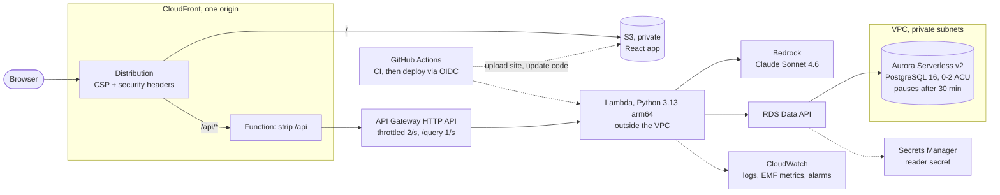
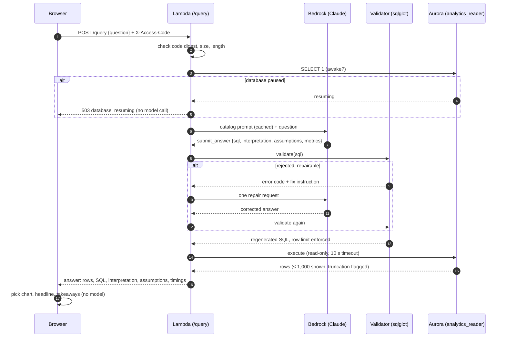
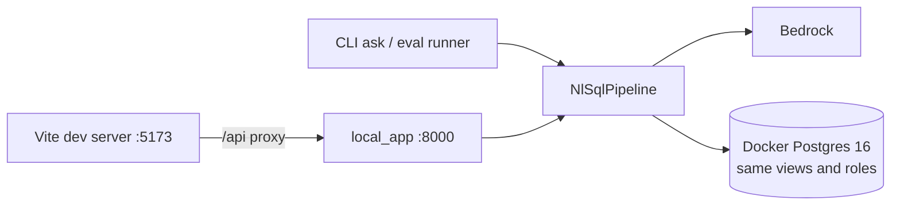

# Architecture

Two views: where things run, and what happens to one question. The reasons behind
each choice are in the [ADRs](adr/README.md).

## Where things run

- **One origin.** The browser only ever talks to CloudFront. `connect-src 'self'` in
  the CSP is enough, and there's no CORS to configure.
- **No VPC Lambda, no NAT gateway.** The Lambda reaches Aurora through the Data API
  over HTTPS, using the reader's secret. It never holds a database connection, so
  Aurora can pause.
- **Scale to zero.** When Aurora is paused, `/status` answers `resuming` straight
  away. The UI polls it and shows "Starting analytics database…" until it's ready,
  because a resume takes 20–90 s and API Gateway gives up after 30 s
  ([spike](spikes/aurora-resume.md)).
- **Code-only deploys.** Every merge to `main` runs CI, then `deploy.yml` uploads the
  site and updates the Lambda code with short-lived OIDC credentials. Infrastructure
  changes go through `terraform plan` and a manual apply.

## One question, end to end

What each step guarantees:

| Step | Guarantee | Where |
|---|---|---|
| Prompt | The model only sees exposed views, columns, relationships and metric definitions, generated from one catalog | [prompts.py](../backend/src/olist_nlsql/llm/prompts.py), [catalog.yaml](../backend/src/olist_nlsql/catalog/catalog.yaml) |
| Model call | A forced `submit_answer` tool call, parsed strictly, at most 2 calls per question | [bedrock.py](../backend/src/olist_nlsql/llm/bedrock.py), [pipeline.py](../backend/src/olist_nlsql/pipeline.py) |
| Validation | Single SELECT, allowlisted views, columns and functions, catalog joins only, no fan-out, LIMIT enforced, rankings sort NULLs last | [sql-safety.md](sql-safety.md) |
| Execution | The validator's SQL, never the model's text, as a read-only role on the analytics views only | [security.md](security.md) |
| Presentation | Chart, headline and takeaways computed from the rows in the browser; SQL and assumptions always shown | [selectChart.ts](../frontend/src/charts/selectChart.ts), [summary.ts](../frontend/src/lib/summary.ts) |

## Locally

The same pipeline runs against Docker Postgres with `PostgresExecutor` in place of
the Data API ([local-development.md](local-development.md)). The evaluation harness
uses that path, or a deployed API with `--api-url`, so a benchmark run exercises
exactly the code that serves the site.

